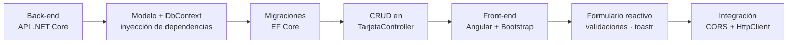
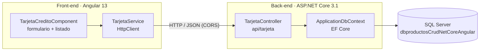

<div align="center">

# 💳 CRUD de Tarjetas de Crédito: Angular + .NET Core + SQL Server

**Aplicación full stack para registrar, listar, editar y eliminar tarjetas de crédito, con un frontend en Angular y una API REST en ASP.NET Core con Entity Framework Core y SQL Server.**


</div>

---

## 📖 Sobre este repositorio

Proyecto práctico para aprender a construir una aplicación **full stack** que conecta un **frontend en Angular**
con una **API REST en ASP.NET Core**, usando **Entity Framework Core** (*Code First* con migraciones) sobre **SQL Server**.

La aplicación administra **tarjetas de crédito**: titular, número de tarjeta, fecha de expiración y código de seguridad.
En una sola pantalla se ve el formulario y el listado, y cada acción muestra una notificación.

> [!NOTE]
> Es un proyecto de estudio. Los datos de tarjetas se guardan en texto plano, algo que nunca debe hacerse en
> un sistema real (allí se usa tokenización y cumplimiento de PCI DSS).

## 🗺️ Cómo se construyó



## 🏗️ Arquitectura



## ✨ Funcionalidades

- ➕ **Agregar** una tarjeta desde un formulario validado.
- 📋 **Listar** las tarjetas guardadas.
- ✏️ **Editar** una tarjeta: el mismo formulario cambia de "Agregar" a "Editar".
- 🗑️ **Eliminar** una tarjeta.
- 🔔 **Notificaciones** de éxito, información y error con **ngx-toastr**.
- 📖 **Documentación de la API** con **Swagger UI**.

## 📚 Temas vistos

<details open>
<summary><b>Back-end: ASP.NET Core Web API</b> · <code>Back-end/</code></summary>

| Tema | Dónde |
|---|---|
| Proyecto Web API en **.NET Core 3.1** y configuración en `Startup.cs` | `Program.cs`, `Startup.cs` |
| **Inyección de dependencias** del `ApplicationDbContext` | `Startup.cs` |
| Modelo con **Data Annotations** (`[Required]`) | `Models/TarjetaCredito.cs` |
| **Entity Framework Core Code First** y **migraciones** (`Add-Migration`, `Update-Database`) | `Migrations/` |
| Cadena de conexión a **SQL Server** | `appsettings.json` |
| Controlador REST con `GET`, `POST`, `PUT` y `DELETE` y métodos **asíncronos** (`async` / `await`) | `Controllers/TarjetaController.cs` |
| **CORS** para permitir peticiones desde Angular | `Startup.cs` (política `AllowWebApp`) |
| Documentación con **Swagger** (Swashbuckle) | `Startup.cs` |

**Endpoints**

| Método | Ruta | Acción |
|---|---|---|
| `GET` | `/api/tarjeta` | Listar tarjetas |
| `GET` | `/api/tarjeta/{id}` | Obtener una tarjeta |
| `POST` | `/api/tarjeta` | Crear una tarjeta |
| `PUT` | `/api/tarjeta/{id}` | Actualizar una tarjeta |
| `DELETE` | `/api/tarjeta/{id}` | Eliminar una tarjeta |

</details>

<details>
<summary><b>Front-end: Angular</b> · <code>Front-end/TarjetaCredito/</code></summary>

| Tema | Dónde |
|---|---|
| Proyecto creado con **Angular CLI 13** | `angular.json` |
| **Componentes**: `TarjetaCreditoComponent` | `src/app/components/tarjeta-credito/` |
| **Servicios** e `HttpClient` para consumir la API | `src/app/services/tarjeta.service.ts` |
| **Formularios reactivos** (`FormGroup`, `formControlName`, `ngSubmit`) | componente `tarjeta-credito` |
| **Validaciones**: campos obligatorios, número de 16 dígitos, fecha `MM/YY` de 5 caracteres y CVV de 3 | componente `tarjeta-credito` |
| Directiva `*ngFor` y *pipe* `uppercase` en el título del formulario | `tarjeta-credito.component.html` |
| Notificaciones con **ngx-toastr** y `BrowserAnimationsModule` | `app.module.ts` |
| Estilos con **Bootstrap 5**, **Font Awesome 6**, **Google Fonts** y un degradado de **uiGradients** | `index.html`, `styles.css` |

</details>

## 🛠️ Tecnologías

| Capa | Herramientas |
|---|---|
| Front-end | Angular 13, TypeScript 4.5, RxJS, Bootstrap 5, ngx-toastr, Font Awesome 6, Google Fonts |
| Back-end | ASP.NET Core 3.1 Web API, C# |
| Persistencia | Entity Framework Core 3.1 (Code First, migraciones) |
| Base de datos | SQL Server Express |
| Documentación | Swagger (Swashbuckle.AspNetCore) |
| Herramientas | Visual Studio, Visual Studio Code, Node.js / npm |

## 🚀 Cómo ejecutar el proyecto

### Requisitos

- [.NET Core SDK 3.1](https://dotnet.microsoft.com/download/dotnet/3.1) y Visual Studio 2019/2022 (o `dotnet` CLI).
- SQL Server o SQL Server Express.
- Node.js 16 y Angular CLI 13 (`npm install -g @angular/cli@13`).

### 1. Back-end

1. Abre `Back-end.sln` en Visual Studio.
2. Cambia el servidor en `Back-end/appsettings.json` (`DefaultConnection`; por defecto `DESKTOP-LBC8NAB\SQLEXPRESS`).
3. Crea la base de datos aplicando las migraciones:

   ```bash
   cd Back-end
   dotnet ef database update
   ```

   o, desde la Consola del Administrador de Paquetes, `Update-Database`.
4. Ejecuta la API con **IIS Express** (**F5**). Swagger queda disponible en `https://localhost:44361/swagger`.
   Con `dotnet run` la API usa `https://localhost:5001`.

### 2. Front-end

```bash
cd Front-end/TarjetaCredito
npm install
ng serve -o
```

La aplicación abre en `http://localhost:4200` y consume la API en `https://localhost:44361/api/tarjeta/`.
Si tu API usa otro puerto, cámbialo en `src/app/services/tarjeta.service.ts` (`myAppUrl`).

## 📂 Estructura del repositorio

```text
.
├── Back-end.sln
├── Back-end/                       # API REST en ASP.NET Core 3.1
│   ├── Controllers/
│   │   └── TarjetaController.cs    # CRUD de tarjetas
│   ├── Models/
│   │   └── TarjetaCredito.cs       # Entidad
│   ├── Migrations/                 # Migraciones de EF Core
│   ├── ApplicationDbContext.cs
│   ├── Startup.cs                  # DI, CORS, Swagger
│   └── appsettings.json            # Cadena de conexión
└── Front-end/
    └── TarjetaCredito/             # Aplicación Angular 13
        └── src/app/
            ├── components/tarjeta-credito/
            └── services/tarjeta.service.ts
```

## 👤 Autor

**Jairo Alejandro Castañeda Pedraza**

[](https://github.com/JairoCastanedaP)

---

<div align="center">

⭐ Si este repositorio te sirve como guía de estudio, ¡déjale una estrella!

</div>
